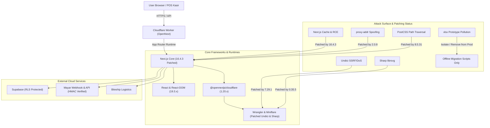

# Architecture & Security Topology — Ela Parfum

## Tech Stack
- **Framework:** Next.js 16 (App Router, Turbopack)
- **Deployment Platform:** Cloudflare Workers via `@opennextjs/cloudflare` + `wrangler`
- **Database & Auth:** Supabase (PostgreSQL, Row Level Security, Storage)
- **Payment Gateways:** Mayar (QRIS/E-Wallet/VA), Midtrans
- **Logistics & Tracking:** Biteship API
- **Styling & Motion:** Tailwind CSS, Framer Motion, Motion, Lucide Icons

## Dependency & Security Graph

## Keputusan Arsitektur Keamanan
1. **Targeted Patching over Major Bumping:** Menghindari upgrade major blind (`npm update` sembarangan) yang merusak integrasi Cloudflare OpenNext dan TypeScript.
2. **Isolasi Modul Rentan (`xlsx`):** Mengeliminasi modul parser rentan dari bundle production karena seluruh operasi Excel runtime web ditangani oleh `exceljs`.
3. **Zero-Downtime Patch:** Menjamin build Turbopack dan build worker Cloudflare 100% hijau sebelum perilisan.
